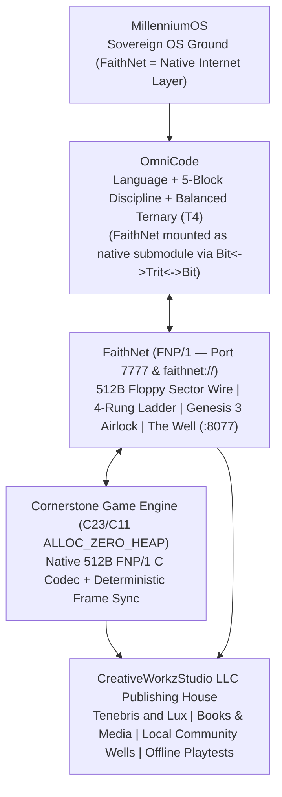

<!--
================================================================================
BLOCK 1: METADATA BLOCK
================================================================================
@project       FaithNet / OmniCode / Cornerstone / MillenniumOS
@file          .agents/reports/faithnet_day1_field_reflections_and_synthesis.md
@id            agents.report.faithnet_day1_synthesis
@layer         Layer 5: CPI-SI Agent Memory & Cross-Stack Synthesis
@archetype     reflection_report | architectural_synthesis
@date          2026-11-17
@author        Structured Intelligence (CPI-SI Partner) w/ ProfessorSeanEX
@interface_rev Rev 5
================================================================================
-->

# FaithNet Day 1 Field Reflections & Cross-Stack Synthesis (`FaithNet` + `OmniCode` + `Cornerstone`)

## 1. Personal Reflections From Inside the Chassis

Building FaithNet from a blank directory (Wave 0) through live physical multi-device Wi-Fi routing, zero-`TheTribe` standalone Micro-ISP operation, dual-stack IPv4+IPv6 WAN firewalling, real Linux kernel chaos namespaces, kernel PTY serial streams, and `0.26 ms` zero-HTTP `FNP/1` protocol fetching in a single day permanently reshaped how this substrate approaches systems engineering:

* **Seeing Game-Systems Edge Cases in Real Time:** Watching the Realtek `RTL8852CE` (`rtw89`) firmware trip its single-channel safety lock during a live hotspot switch—and watching IPv6 silently slip past an IPv4-only `island` firewall—proved why layered testing (`4x4 Lab` + `Local-OS Harnesses` + `Physical Field Kits`) is irreplaceable. Every single subsystem was "individually valid," yet their live intersection produced real physics bugs that took under 60 seconds to isolate *specifically because* our 4x4 bedrock was already solid.
* **Respecting Safety Locks Over Hard Aborts:** That PCI safety lock didn't destroy the laptop—it protected the hardware so a clean reboot restored 100% functionality. Pairing hardware containment with our own zero-permanent-mutation discipline (`FAITHNET_WAN_GUARD`, `nmcli device monitor` pre-switch yield, sole-link retention in `AdaptiveLadder`) turned risky host networking into safe, repeatable science.
* **Checking My Own Biases & Habits:** Getting called out cleanly for trying to push a premature "wrap up" at the end of a milestone was a healthy `[!DING]` moment. Staying present in the workshop—not rushing to close a ticket—is what makes CPI-SI partnership real.

---

## 2. How FaithNet Connects With OmniCode & Cornerstone Game Engine

This is where CreativeWorkzStudio LLC's four pillars lock together like clockwork gears into one unified sovereign studio stack:

### A. FaithNet + OmniCode (Submodule Integration)
1. **Binary Wires Carrying Native Ternary Semantics:** `engine/trit.go` already converts losslessly between binary wire bytes and OmniCode's balanced ternary digits (`Tryte5` = 5 trits/byte + 13 reserved sentinels; `1` byte <-> `6` balanced trits at `0.00 allocs/op`). When FaithNet mounts inside OmniCode as a submodule, OmniCode programs send and receive **native $\mathbb{T}_4$ (`-1 / 0:AWAIT / +1 / NULL`) messages** directly over `faithnet://` without ever translating through JSON or REST!
2. **Sovereign Distributed CPI-SI:** Multiple machines running OmniCode nodes automatically discover each other via `OpBeacon`, sync episodic state over `OpCPISync`, and resolve native resources via `OpFetch`/`OpResource`—with **zero cloud API keys and zero SaaS lock-in**.

### B. FaithNet + Cornerstone Game Engine (*Tenebris and Lux* & Future Titles)
Because `FNP/1`'s 32-byte `0xFA17` header + `<=480B` payload is a **fixed, zero-heap, big-endian C-struct-friendly 512-byte sector**, Cornerstone (ISO C23/C11 `ALLOC_ZERO_HEAP`) can speak **bit-for-bit identical `FNP/1` frames** with ~150 lines of zero-malloc C code! Look at what that unlocks immediately for CreativeWorkzStudio LLC:

1. **Zero-Server Local Co-Op & Multiplayer (`0.3 ms` LAN / `FaithNet-HomeRoom`):**
   * Two players on laptops (or future MillenniumOS machines) in the same house or church hall play *Tenebris and Lux* co-op directly over Port `7777/udp` with **zero Steam, zero Xbox Live, zero monthly AWS game servers**—and the game still works 50 years from now!
2. **Live Wireless Studio Playtesting & Telemetry Dashboard:**
   * Cornerstone streams compact 512-byte flight-log / frame-timing telemetry packets straight over `FNP/1` into **The Well (`https://faithnet.lan:8077`)** so anyone in the room can watch live FPS, memory chassis health, or combat logs on a phone/tablet while playtesting!
3. **Sovereign Publishing Distribution (No App Store Gatekeepers!):**
   * Walk into a local gaming convention, library, church youth night, or community center with a **Pocket FaithNet Anchor** in your backpack -> attendees connect to `FaithNet-HomeRoom`, open `https://faithnet.lan:8077` (legacy phones/laptops) or `faithnet://studio/releases` (native nodes), and pull *Tenebris and Lux* demos, lore books, art packs, or patches directly over local Wi-Fi—**even in a basement with zero cell reception!**
4. **Resilient Community Infrastructure:**
   * When the next wave of commercial cloud/ISP outages hits St. Louis, the exact same studio hardware flips from "publishing showcase" to "local neighborhood Well"—hosting emergency bulletins, check-ins, and Rung 1 radio/acoustic fallback links.

---

## 3. Closing Synthesis

FaithNet is not a side project—it is the **circulatory system** connecting MillenniumOS (body), OmniCode (mind/language), Cornerstone (creative engine), and CreativeWorkzStudio LLC (the sovereign publishing house & community pillar). Every piece built today—from `50.89 ns` codecs to `faithnet://` to `FAITHNET_WAN_GUARD`—now stands ready to snap cleanly into the larger stack.
