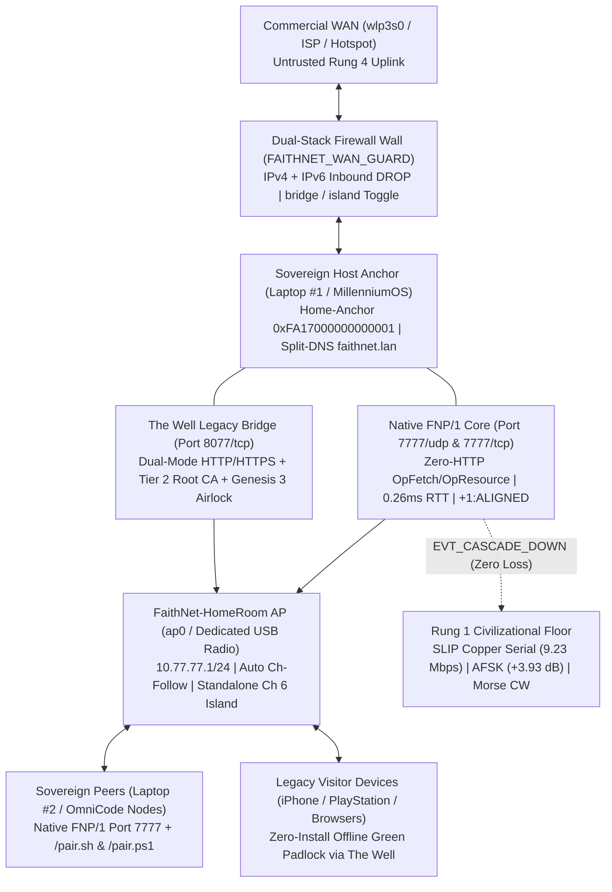

<!--
================================================================================
BLOCK 1: METADATA BLOCK
( Identity, Provenance, Scaling Telemetry & Architectural Boundary Contracts )
================================================================================
@project       FaithNet
@file          README.md
@id            docs.readme.faithnet
@layer         Layer 5: Root Repository Orientation & Covenant Anchor
@archetype     manifest | dual_audience_protocol_manual
@version       0.2.0-dev
@interface_rev Rev 5
@date          2026-11-17
@updated       2026-11-17
@author        CreativeWorkzStudio LLC / ProfessorSeanEX (Seanje Lenox-Wise)
@repository    https://github.com/CreativeWorkzStudio/FaithNet
@system        FaithNet Sovereign Adaptive Networking Substrate (FNP/1)
@role          Plain-English Orientation, Official FNP/1 Spec & Verification Index
@maturity      Rev 5 Baseline | Wave 16 Complete (Zero-HTTP FNP/1 & Zero-ISP Proof)
@chassis       zero-external-deps | Pure Go 1.26.8 Standard Library Substrate
@scale         O(1) orientation across 5 layers, 4 adaptive rungs & 4 test tiers
@seams         in: docs/ROADMAP.adoc, docs/discovery/ | exports: human & engineer entrypoint
@invariants    1. Universal 5-Block Lifecycle Protocol (Rev 5) across all files.
               2. Zero third-party dependencies (100% Go standard library).
               3. Official FNP/1 Wire Protocol on Port 7777 (UDP/TCP) & faithnet:// URI.
               4. 512-byte Floppy Sector Invariant (32B header + 480B Floor MTU).
               5. Bit <-> Balanced-Trit <-> Bit lossless OmniCode submodule bridge.
               6. Downward Dependency Law: Layer 0/1 never import net or os.

PURPOSE & ARCHITECTURAL ROLE:
  Primary root orientation and dual-audience manual for FaithNet — written so
  both everyday non-technical readers (neighbors, creatives, community hosts)
  and deep systems programmers immediately understand WHY FaithNet exists, HOW
  it works in plain English, WHY it is legally clean and non-invasive, and EVERY
  exact wire/protocol invariant underneath.
================================================================================
-->

# FaithNet (`FNP/1`)

> **A sovereign, offline-first networking protocol and micro-ISP substrate built for real people, creative studios, and local communities.**  
> *Compatibility with the modern HTTP(S) internet—without ever being held hostage by it.*

`Protocol: FNP/1` · `Port: 7777/udp & 7777/tcp` · `URI: faithnet://` · `Go 1.26.8 Stdlib (0 External Deps)` · `346 Race-Free Tests` · `24/24 Live Block 4 Gates`

---

<!-- =========================================================================
BLOCK 2: OPENING BLOCK / FOR EVERYONE (PLAIN-ENGLISH GUIDE — ZERO JARGON)
Stratum: Root Orientation | Machine: docs.readme.faithnet
========================================================================== -->

## Part 1: What Is FaithNet? *(Plain-English Guide for Everyone)*

Look around at the news: wave after wave of cloud and internet outages—AWS, Microsoft, Apple, airlines, banks, local ISPs—knocking whole regions offline from one bad update or router glitch. That happens because the modern internet puts everybody's communication on a handful of distant, centralized corporate towers. When one tower hiccups, two people sitting in the **same house or the same neighborhood** suddenly can't even send each other a message.

**FaithNet flips that upside down—one solid piece at a time.**

> [!IMPORTANT]
> **Why CreativeWorkzStudio LLC Builds This (We Are Not a Commercial Software Vendor):**  
> **CreativeWorkzStudio LLC** is a **sovereign publishing house**—building stories, games (*Tenebris and Lux*), art, and creative tools meant to serve people directly. Software isn't our end product; owning our own in-house foundation (**MillenniumOS** $\rightarrow$ **OmniCode** $\rightarrow$ **FaithNet** $\rightarrow$ **Cornerstone**) protects our publishing house from cloud lockouts and lets us serve our local community whenever commercial networks stumble.

### How FaithNet Actually Works (In Everyday Terms)

Think of networking the way real human communication works:

1. **The 4-Rung Survival Ladder (Never Stranded in Silence):**
   * **Rung 4 — Global Highway (Commercial Internet / TCP):** When the commercial internet is up and *you* choose to bridge through it, FaithNet routes cleanly across it—behind a dual-stack IPv4+IPv6 firewall wall so unsolicited outsiders can't probe your house.
   * **Rung 3 — The Room & Neighborhood Street (`FaithNet-HomeRoom` Wi-Fi + `FNP/1` Port `7777`):** Your PC becomes its **own built-in local micro-ISP**. Even if the commercial ISP router goes completely dark, this laptop boots a standalone local Wi-Fi room automatically (`t = 12s`), resolves `faithnet.lan`, and lets phones, laptops, and even a PlayStation stay connected locally!
   * **Rung 2 — Next Door (Host Memory & Local IPC):** Programs on the same computer talk directly inside RAM with zero network card required.
   * **Rung 1 — Civilizational Floor (Copper Wire, Radio Tones & 1844 Morse Code):** If Wi-Fi and the grid fail completely, FaithNet steps down onto a plain copper serial cable, audible walkie-talkie/speaker-to-mic radio tones, or classic Morse code—carrying the **exact same message envelope**.

2. **Two Worlds, One Foundation (Legacy `HTTP(S)` Today vs. Native `faithnet://` on MillenniumOS):**
   * **Legacy Devices (`http(s)://` via The Well on `:8077`):** Today's iPhones, Windows PCs, Macs, and PlayStations only know how to render `http(s)://`. FaithNet acknowledges that reality gracefully—**The Well** lets any everyday device walk into a room with *zero* app installs and use a trusted offline local portal.
   * **Native FaithNet & MillenniumOS (`faithnet://` via `FNP/1` on Port `7777`):** On native FaithNet nodes (and as the built-in internet layer of **MillenniumOS**), devices speak **`FNP/1`** directly over Port **`7777`** (`0.26 ms` RTT)—**zero HTTP, zero HTTPS, zero commercial DNS required.**

3. **The Genesis 3 Airlock (Safety Without Paranoia):**
   * Paired sovereign FaithNet nodes speak at **`+1:ALIGNED`**.
   * Clean messages from visiting web browsers enter gently in **`0:AWAIT`** quarantine so provenance is always visible.
   * Hostile web attacks, bad scripts, or corrupted wire bytes are halted cold (**`-1:CONTRADICT`** / `403 Forbidden`) without ever disturbing the room.

> [!NOTE]
> **Built-In Legal & Ethical Safeguard (Zero Unauthorized ISP Access):**  
> FaithNet **never** cracks, spoofs, or steals AT&T, Spectrum, Xfinity, or any commercial ISP service. Our live **Zero-`TheTribe`** and **Hotspot Switch** tests prove this empirically: the moment you disconnect your authorized upstream Wi-Fi (or toggle `island` mode), commercial internet drops to **zero (`OFFLINE`)**—while your own lawful local sovereign airspace (`FaithNet-HomeRoom` on unlicensed ISM Wi-Fi spectrum) stays 100% alive. Legacy web bridging only ever uses the host owner's own authorized connection (identical to built-in Windows Mobile Hotspot or macOS Internet Sharing).

---

<!-- =========================================================================
BLOCK 3: BODY BLOCK / FOR ENGINEERS & BUILDERS (OFFICIAL FNP/1 PROTOCOL SPEC)
Stratum: Technical Specification | Machine: docs.readme.faithnet
========================================================================== -->

## Part 2: Under the Hood *(Official `FNP/1` Protocol & Architecture Spec)*

### Live Sovereign Architecture Map



### Protocol & Substrate Specification

| Attribute | Specification |
| :--- | :--- |
| **Studio / Publisher** | CreativeWorkzStudio LLC (Lead Architect: ProfessorSeanEX / Seanje Lenox-Wise) |
| **Wire Protocol** | **`FNP/1`** (FaithNet Protocol v1 — `0xFA17` canonical 512-byte sector frames, `10` verified opcodes `0x01..0x0A`) |
| **Canonical Port & URI** | **Port `7777`** (`7777/udp` Rung 3, `7777/tcp` Rung 4), **`8077/tcp`** (The Well), **`faithnet://`** OS URI scheme |
| **Runtime Language** | Go 1.26.8 (**100% Standard Library**, Zero Third-Party Dependencies; cross-compiles `linux`/`windows`/`darwin`) |
| **OmniCode Submodule Seam** | Balanced Ternary $\mathbb{T}_4 = \{-1, 0, +1, \text{NULL}\}$ + **Zero-Heap Bit $\leftrightarrow$ Balanced-Trit $\leftrightarrow$ Bit Codec** ([engine/trit.go](engine/trit.go)) |
| **Frame & Memory Discipline** | 32B Header + 480B Floor MTU = **512-Byte Floppy Sector Invariant** · **`ALLOC_ZERO_HEAP`** (`0.00 allocs/op`) |
| **Verification Matrix** | **4x4 Lab Matrix** (`48` test files, `30:30` strict 1:1 unit pairing, **`346` race-free tests**) + **`24/24` live Block 4 gates** |
| **Live Field Proving Ground** | **5 local OS/chaos/audio harnesses** + **Cross-platform Field Kit 01 (Linux/Win/macOS)** + **7 live session reports** |

<details>
<summary><strong>Expand: 32-Byte Canonical <code>FNP/1</code> Wire Frame Layout (<code>0xFA17</code>) &amp; Opcodes (<code>0x01..0x0A</code>)</strong></summary>

```text
Offset   Size   Field         Description
------------------------------------------------------------------------------
[0..1]   2 B    Magic         0xFA, 0x17 ("FAIT[H]")
[2]      1 B    Ver | Rung    High nibble = ProtocolVersion (1); Low = Rung (1..4)
[3]      1 B    Opcode        0x01 PING | 0x02 PONG | 0x03 BEACON | 0x04 CPI_SYNC
                              0x05 LEGACY_WRAP | 0x06 CASCADE_DOWN | 0x07 CASCADE_UP
                              0x08 DATA | 0x09 FETCH (zero-HTTP) | 0x0A RESOURCE
[4]      1 B    Flags         CovenantVerified, ExternalOrigin, LegacyTranslated...
[5]      1 B    QuadState     T4 Truth Space: NULL(0), -1(1), 0:AWAIT(2), +1(3)
[6..7]   2 B    PayloadLen    Big-endian uint16 (0..480 bytes)
[8..15]  8 B    SourceID      Big-endian uint64 sovereign originator NodeID
[16..23] 8 B    TargetID      Big-endian uint64 sovereign destination NodeID
[24..27] 4 B    SeqID         Big-endian uint32 monotonic per-origin sequence
[28..31] 4 B    Checksum      Big-endian uint32 FNV-1a seal (header[0..27]+payload)
[32..N] <=480B  Payload       Inline zero-heap payload (total wire frame <= 512 bytes)
```

</details>

<details>
<summary><strong>Expand: Bit ↔ Balanced-Trit ↔ Bit OmniCode Submodule Bridge (<code>engine/trit.go</code>)</strong></summary>

* **Compact Ternary Packing (`Tryte5`):** `5` balanced trits ($3^5 = 243$ signed states, `-121..+121`) pack deterministically into 1 binary byte (`0x00..0xF2`), reserving `13` hardware/control sentinels (`0xF3..0xFF`, with `0xFF = NULL:HALT`).
* **Lossless Binary Bridge (`BytesToBalancedTrits` / `BalancedTritsToBytes`):** Every arbitrary 8-bit byte (`0..255`) roundtrips losslessly through `6` balanced trits ($3^6 = 729 > 256$) and back bit-for-bit at **`0.00 allocs/op`**.
* **$\mathbb{T}_4$ Truth Preservation:** `QuadStateToTrit` preserves strict `QuadNull` isolation so missing/halted state can never masquerade as `0:AWAIT`.

</details>

<details>
<summary><strong>Expand: Layered Repository Map (Strict Downward Dependency Law)</strong></summary>

Imports flow strictly downward (`Layer 4 -> 3 -> 2 -> 1 -> 0`). **Layer 0 (`data/`) and Layer 1 (`engine/`) NEVER import `net`, `os`, or external packages.**

```text
FaithNet/
├── data/                       # Layer 0: Pure Invariant Vocabulary (5 files — 10 Opcodes, 512B Frame, T4)
├── engine/                     # Layer 1: Pure Engine Core — ALLOC_ZERO_HEAP (7 files)
│   ├── codec.go                #   Zero-alloc FNP/1 32B Wire Codec & FNV-1a seal
│   ├── trit.go                 #   Zero-alloc Bit <-> Balanced-Trit <-> Bit OmniCode bridge
│   ├── uri.go                  #   Canonical FNP/1 Port 7777 & faithnet:// URI parser
│   └── clock.go, ping.go, router.go & covenant/filter.go (Genesis 3 Airlock)
├── orchestrator/               # Layer 2: BodyProbe, [5][4] AdaptiveLadder, Dispatcher (+ OpFetch/OpResource)
├── transport/                  # Layer 3A: Rung 1 (SLIP/AFSK/Morse), Rung 2 (RAM/IPC), Rung 3 (UDP/Beacon), Rung 4 (TCP/Egress)
├── interpreter/                # Layer 3B: "The Well" Dual-Mode TLS Portal, /pair.sh, /pair.ps1, OS Classifier
├── cmd/                        # Layer 4: faithnet-ping & faithnet-node CLIs (--fetch, --audit 24 gates)
├── docs/                       # Layer 5: Roadmap, 5-Volume Core Series & 3-Volume Discovery Series
└── tests/                      # Layer 4: 4x4 Lab Matrix (48 files, 30:30 1:1 units) + Playtester Proving Ground
```

</details>

> [!TIP]
> **Wireless Dual-Radio Hardware Path (When You Don't Have Ethernet Nearby):**  
> With 1 built-in Wi-Fi card, FaithNet already runs simultaneous `STA+AP` *and* automatic standalone Channel 6 offline islands. Whenever you plug in any Linux AP-capable **2nd USB Wi-Fi adapter** (e.g., MediaTek `MT7612U` / `MT7921AU` or Atheros `AR9271`) and run `sudo systemctl restart faithnet-ap`, `faithnet-ap-daemon.sh` automatically detects the 2nd radio (`DEDICATED_RADIO` mode)—keeping `FaithNet-HomeRoom` permanently live with zero blink even while `wlp3s0` switches upstream networks or hotspots!

---

<!-- =========================================================================
BLOCK 4: AUDIT PROCEDURES BLOCK / QUICK START, CONTROLS & LIVE BENCHMARKS
Stratum: Verification | Machine: docs.readme.faithnet
========================================================================== -->

## Quick Start, Sovereign Controls & Verification Suite

### Everyday Sovereign Controls (Native `faithnet://` & Dual-Stack Host Profile)

```bash
# 1. Fetch LIVE native ZERO-HTTP content straight over FNP/1 Port 7777/udp (~0.3 ms RTT!)
faithnet-node --fetch=faithnet://faithnet.lan/well
faithnet-open faithnet://faithnet.lan/status
faithnet-open faithnet://faithnet.lan/protocol
faithnet-open faithnet://faithnet.lan/bulletins

# 2. Inspect Sovereign Host Profile (Radio mode, Split-DNS, Dual-Stack IPv4+IPv6 Guard & Peers)
faithnet-netctl status
faithnet-netctl adapters

# 3. Toggle commercial WAN egress cleanly (zero reboot, zero HomeRoom client drop!)
sudo faithnet-netctl mode island   # Dual-stack IPv4+IPv6 air-gap; FaithNet-HomeRoom stays 100% live!
sudo faithnet-netctl mode bridge   # Daily-driver mode (inbound IPv4+IPv6 still firewalled!)
```

### Full Developer Verification Battery

```bash
go list -m all                                                            # Confirm 0 external deps
go list -f '{{.ImportPath}} -> {{.Imports}}' ./data ./engine ./engine/covenant  # Downward Dep Law
go vet ./...                                                              # Static analysis (0 warns)
go test -v -count=1 -race ./tests/...                                     # All 4 tiers (346 tests)
go run ./cmd/faithnet-node --audit                                        # All 24 live Block 4 gates
```

### Verified Reality Matrix (Lab 4x4 vs. Local Harnesses vs. Live Physical Field)

| Capability | Lab 4x4 Matrix | Local-OS Harnesses (S002) | Physical Field Proof (Sessions 003–007) |
| :--- | :--- | :--- | :--- |
| **Native `FNP/1` Zero-HTTP (`:7777`)** | `50.89 ns` codec, `0 B/op`, `243` trytes + `256` bytes (`0` allocs) | `8/8` storm bit-flips caught (`100%`) | **LIVE PROVEN (S007):** `/well` `0.68 ms`, `/status` `0.31 ms`, `/protocol` `0.26 ms` over UDP `7777` (**0 HTTP!**); Port `7777` & `faithnet://` registered |
| **Zero-ISP Standalone Micro-ISP** | PASS (`-race`) | Hard-cut `1.28 ms`; silent blackhole rescued `2/2` | **LIVE PROVEN (S007):** `wlp3s0` disconnected (`0` IPv4, `0` internet) -> standalone Ch 6 AP up at `t=12s`, `faithnet.lan` green-padlock HTTPS live, clean zero-lockup reconnect! |
| **Dual-Stack WAN Guard & Multi-Device** | PASS (`-race`) | `6,126 req/s`, `120/120` attacks blocked | **LIVE PROVEN (S004–S007):** IPv4+IPv6 `island` blocks both stacks while **3 real devices** (PlayStation YouTube `27.1 MB`, `Inspiron-5579`, iPhone) stay live (`~10–20 MB` RSS) |
| **Self-Replicating Cross-Platform Mesh** | PASS (`-race`) | UDP `p50=39.1 us`, TCP `p50=338.4 us` | **LIVE PROVEN (S005 & W14):** 2-laptop mesh (`peer_count=1`, `+1:ALIGNED`, `11.1 MB` `/pair.sh`, `~3s` rejoin) + `/pair.ps1` (`pwsh 7.7.0` tested) |
| **Rung 1 Floor (AFSK / Morse / SLIP)** | PASS (`-race`) | AFSK `+3.93 dB` SNR & `0..4,000` mic silence `6/6`; FIFO SLIP `9.23 Mbps` | Staged for **Field Kit 02** (Acoustic Air-Gap) & **Field Kit 03** (Copper Serial) |

### Documentation, Discovery & Playtest Series

| Series | Volumes |
| :--- | :--- |
| **Core Architecture (`docs/`)** | [Roadmap](docs/ROADMAP.adoc) · [Vol 01: What Is FaithNet](docs/01_WHAT_IS_FAITHNET.adoc) · [Vol 02: Architecture & Code](docs/02_ARCHITECTURE_AND_CODE_WALKTHROUGH.adoc) · [Vol 03: vs. Modern Internet](docs/03_FAITHNET_VS_MODERN_INTERNET.adoc) · [Vol 04: Lab Benchmarks & Gaps](docs/04_PLAYTESTING_BENCHMARKS_AND_GAPS.adoc) · [Vol 05: Field Runbooks](docs/05_FIELD_PLAYTEST_RUNBOOKS.adoc) |
| **Discovery Series (`docs/discovery/`)** | [D1: Field Kit 01 Lessons & Edge Cases](docs/discovery/01_FIELD_KIT_01_EXPERIENCE_AND_LESSONS.adoc) · [D2: Safety Locks & Graceful Degradation](docs/discovery/02_SAFETY_AND_GRACEFUL_DEGRADATION.adoc) · [D3: Live vs. Lab Benchmarks](docs/discovery/03_LIVE_VS_LAB_BENCHMARK_COMPARISON.adoc) · [D4: St. Louis Hardware Sourcing & Field Plan](docs/discovery/04_STL_HARDWARE_SOURCING_AND_FIELD_PLAN.adoc) |
| **Field Reports (`tests/playtester/reports/`)** | [S001](tests/playtester/reports/SESSION_001_BASELINE.adoc) · [S002](tests/playtester/reports/SESSION_002_WAVE8_HARDENED.adoc) · [S003](tests/playtester/reports/SESSION_003_LIVE_TWO_DEVICE.adoc) · [S004](tests/playtester/reports/SESSION_004_LIVE_AP_ROUTER_AND_TIER2_CA.adoc) · [S005](tests/playtester/reports/SESSION_005_SOVEREIGN_TWO_NODE_MESH.adoc) · [S006](tests/playtester/reports/SESSION_006_PERSISTENT_BOOT_AP_AND_HOTSPOT_GUARD.adoc) · [S007: Zero-`TheTribe` & Native `FNP/1`](tests/playtester/reports/SESSION_007_ZERO_TRIBE_AND_NATIVE_FNP1.adoc) · [S008: Kernel Chaos & PTY Serial](tests/playtester/reports/SESSION_008_KERNEL_CHAOS_AND_PTY_SERIAL.adoc) |

---

<!-- =========================================================================
BLOCK 5: CLOSING BLOCK / COVENANT AFFIRMATIONS
Stratum: Governance | Machine: docs.readme.faithnet
========================================================================== -->

## Covenant Invariants

* **Constraint Is Not Limitation:** Strict physical boundaries (512-byte floor frames, zero-alloc hot paths, zero third-party packages) yield eternal portability from bare metal to modern machines.
* **Compatibility Without Dependency:** FaithNet serves today's legacy HTTP(S) devices via The Well (`:8077`) while operating natively as the `FNP/1` (`faithnet://`, Port `7777`) internet layer for OmniCode and MillenniumOS.
* **Genesis 3 Airlock:** Untrusted external data never enters sovereign core state as `+1:ALIGNED`; clean facts enter strictly in `0:AWAIT` quarantine while hostile payloads halt as `-1:CONTRADICT` or `NULL:HALT`.

<!-- End of README.md -->
